# CareLoop SG

CareLoop SG supports Singapore seniors with hypertension between doctor visits.
It stays quiet until something is wrong for *this* senior, then hands over to their family,
or to their Active Ageing Centre (AAC) if they have no family, with the evidence.

**Rules pick the rung. The model only understands and writes words.**

Tencent Cloud Hackathon SG 2026, Healthcare track, NTU LKCMedicine Challenge 2.

**Try it: https://careloop-sg.onrender.com** (synthetic demo; opens on the video's day, 24 Oct)
- Senior app: [/senior?senior=tan](https://careloop-sg.onrender.com/senior?senior=tan)
- Family app: [/care/family?contact=tan-weiling](https://careloop-sg.onrender.com/care/family?contact=tan-weiling)
- Centre console: [/care/aac?worker=aac-siti](https://careloop-sg.onrender.com/care/aac?worker=aac-siti)
- Add `&demo` to a family or centre link for the demo clock (reset, +1 day, +11 days).

The first visit after a quiet spell can take about a minute: the free service sleeps when nobody uses it,
and when it wakes the demo starts again from 24 Oct.

**How it's built:** [architecture, trust boundaries and design trade-offs](docs/architecture.md).

### How CareLoop uses AI

- **Reading check-ins.** Rules read every check-in first, in English, Singlish and Mandarin (BP, doses, symptoms, red flags). Tencent Hunyuan then adds what rules miss: a symptom said in a roundabout way, the mood, an English gloss. It can add meaning but never remove a finding or invent a number.
- **Writing messages.** Hunyuan drafts each message in the senior's language and tone, inside the step the rules already chose. Every draft passes a guardrail (no diagnosis, no dose change, no stopping a medicine, no calm words on a red flag), or a fixed template goes out.
- **Never deciding.** Rules decide when to step in and who to tell, from the senior's own baseline, so every decision is explainable and tested. Without a model key CareLoop still works, on rules and templates.
- Patterns, the GP brief, medicine notes and the staying-well checklist are rules and statistics, so every line traces back to the data.

## The interfaces

One web build, three apps, one backend. A check-in on the senior app shows up in the family app and the centre console.

| Interface | Address | Who uses it |
|---|---|---|
| Home page | `/` | Everyone: three doors, for seniors, family and centres |
| **Senior app** | `/senior?senior=tan` | The senior: big buttons, hold-to-talk or type, English, Singlish or Mandarin |
| Role chooser | `/care` | Family or centre staff pick who they are |
| **Family app** | `/care/family?contact=tan-weiling` | Family: Today, Health, Plan, Activities, You |
| **CareLoop for Centres** | `/care/aac?worker=aac-siti` | AAC staff: Caseload, Report, Programmes |

The family app and the centre console also print a one-page **GP brief** (PDF) for the doctor.

Screenshots are from the synthetic demo after its fortnight (`POST /demo/advance {"days": 11}`). Mr Tan and Mr Ng are not real people.

### Health apps on the senior's phone

A Fitbit and an OMRON BP cuff both sync to **Apple Health** (iPhone) and **Health Connect** (Android). `backend/healthsync` turns their records into CareLoop readings: steps, resting heart rate, sleep and BP, with nothing typed in. A synced red-flag reading is a red flag at once. Syncing again never counts twice. Fitbit doesn't measure BP; the cuff does.

A web page can't read either store, so this needs a small CareLoop phone app that isn't built yet. **In the demo it is simulated**: five seniors have a synthetic phone, and the "Health apps" card (family Health tab, centre senior page) can sync now or send a cuff reading.

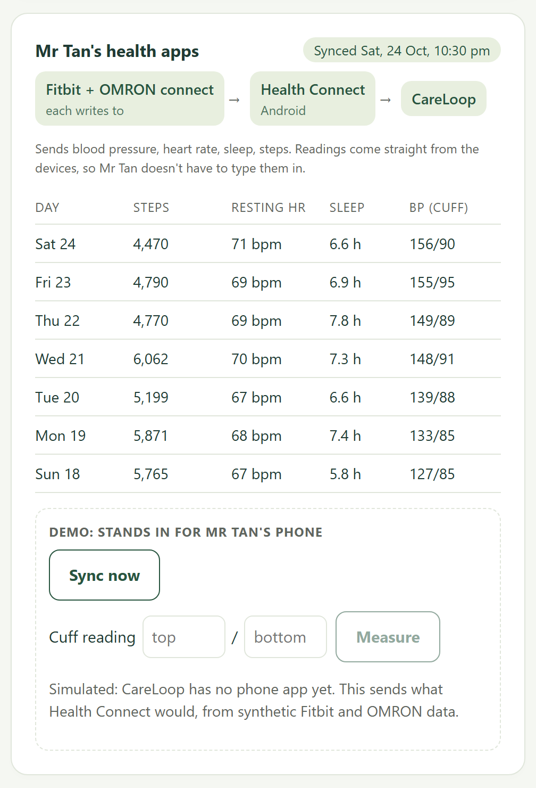

### Medicines and staying well

- **What each medicine is for**, in plain English or Mandarin: what it does, how it helps, what to look out for. From a fixed table, not a model, and never advice: it never says to change, skip or stop a dose. A medicine CareLoop doesn't know (Mr Chandran's Zanidip in the demo) is never guessed at: it says so and points to the pharmacist.
- **Vaccines, screenings and check-ups** that apply to them (flu, pneumococcal, COVID-19, Screen for Life, BP and kidney checks, diabetes eye and foot checks when they have diabetes), with what's due. The family ticks them off; due ones print on the GP brief.
- In the senior app ("My medicines and check-ups"), the family Plan tab and the centre console. Wording is a PLACEHOLDER until the medical student or a pharmacist checks it.

### Activities

- **Suggested automatically, every day.** The senior app shows up to three options each day: programmes at their own centre that match what they like, then the nearest community club. On rainy or hazy days only indoor ones. On a low day (moving less, seeing no one) CareLoop also nudges with the best one. "Not for me" is remembered.
- **Pulled in from what centres already keep.** There's no open feed of AAC or CC programmes (data.gov.sg has their locations only), so a centre imports its own calendar (.ics file or a Google Calendar or Outlook link) or spreadsheet (.csv). CareLoop guesses each programme's tags, indoor or outdoor and fee from the title, shows it all before saving, and pulls a calendar link again every day.

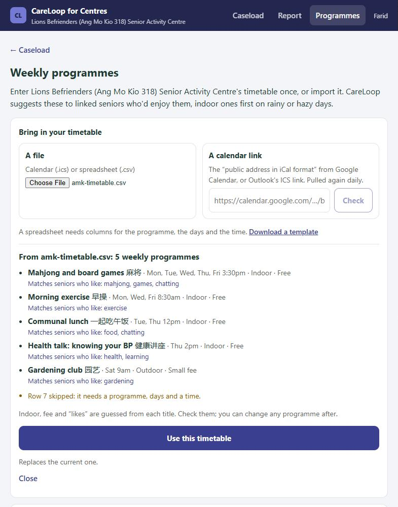

### The demo's people

All synthetic. Twelve seniors, nine family caregivers and two centre befrienders, each with a story over the video's fortnight:

| Senior | Who looks after them | Phone | The fortnight |
|---|---|---|---|
| Mr Tan | Wei Ling (daughter), Kelvin (son) | Fitbit and OMRON, Health Connect | The video: a BP drift, gentle steps, then handed to his family |
| Mdm Wong | Mei (daughter) | | Quiet |
| Mdm Kaur | Priya (daughter, in London), Arjun (son) | Fitbit and OMRON, Apple Health | Quiet; shares readings but not her words |
| Encik Rahman | Nur (daughter), Maria (helper) | Fitbit, Health Connect | Forgets his pill on Sundays: a habit tip |
| Mdm Chua | Jun Jie (son), Hui Min (daughter-in-law) | | One odd reading, then a mild rise, noted; shares a weekly summary only |
| Mdm Lee, Mr Goh | Siti (centre) | | Quiet |
| Mr Ng | Siti (centre) | | Moving less and seeing no one: noted on his centre's caseload; handed over if it carries on |
| Mr Lim | Siti (centre) | Fitbit, Health Connect | Stops answering, but his watch shows him walking, so no alarm |
| Mr Chandran | Siti (centre) | Fitbit and OMRON, Health Connect | A BP drift seen through his cuff: handed to his centre |
| Mdm Yeo | Farid (centre) | | Quiet |
| Mr Osman | Farid (centre) | | No reply and no steps for three dry days: handed to his centre |

Pick any of them at `/care`. Mr Tan, Mdm Wong and Siti also work offline (`npm run dev`); the rest need the API.


### Home page

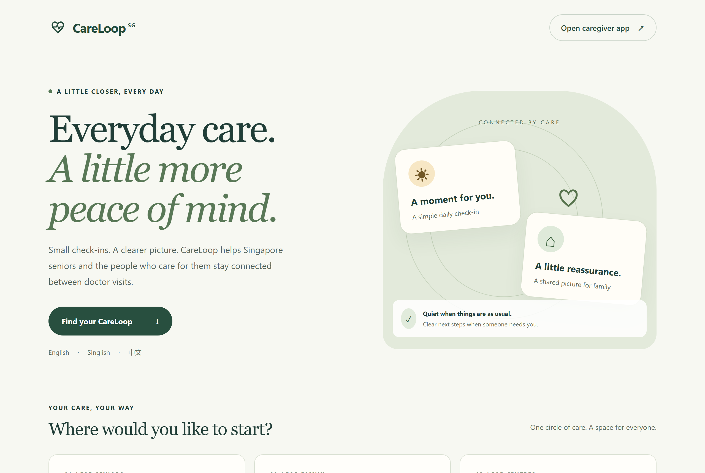

### Senior app

A short daily check-in. Mr Tan can talk or type; CareLoop pulls out the reading and checks anything it isn't sure of.

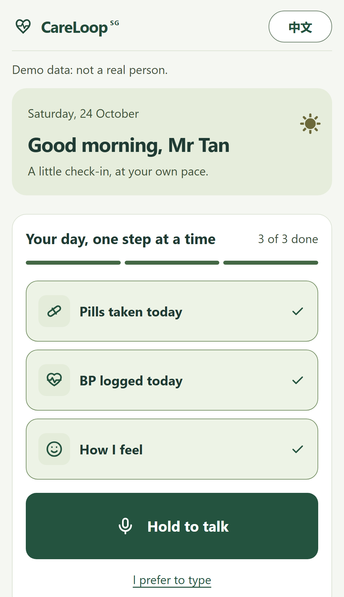

### Family app

| Today | Health | A handover |
|---|---|---|
| 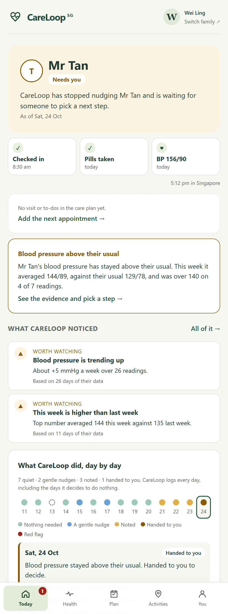 | 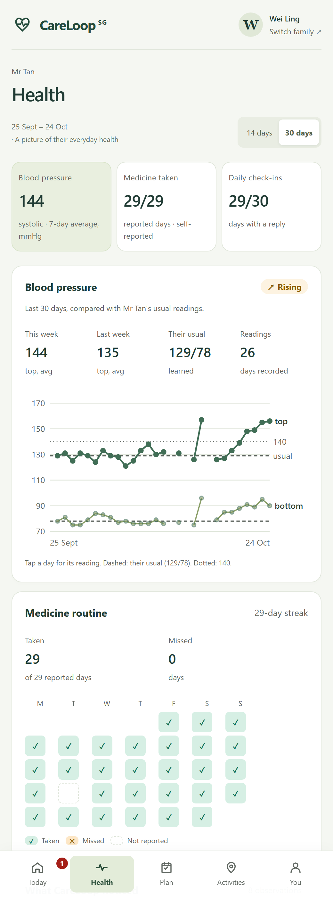 | 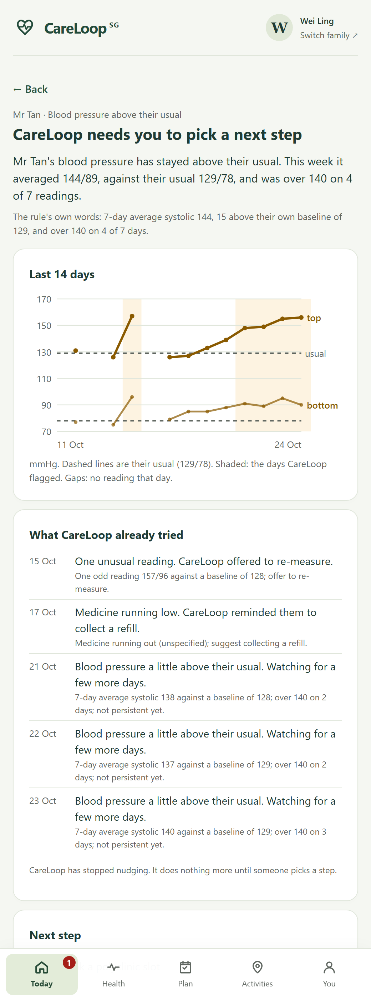 |
| Status, today's check-in, what CareLoop noticed, and every day's decision, quiet days included | 14 or 30 days of blood pressure against their usual, the medicine calendar and steps | Why CareLoop handed over, what it already tried, and the options. Nothing happens until someone picks one |

| Plan |
|---|
| 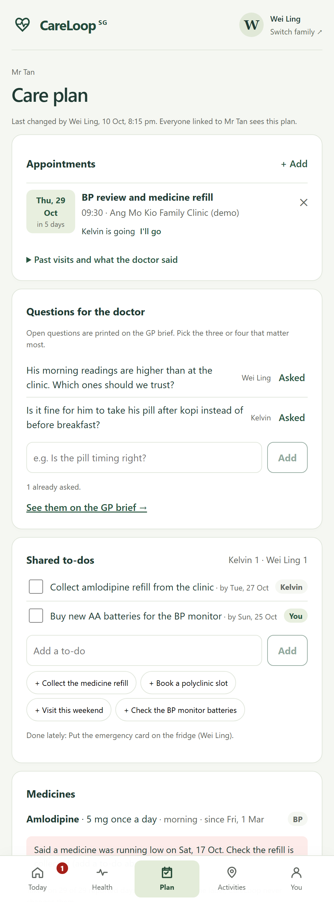 |
| Shared by the whole family: appointments, questions for the doctor (printed on the GP brief), to-dos with owners, medicines and the emergency card |

### CareLoop for Centres

The caseload, sorted by who needs a look. At most one non-urgent alert per senior a week.

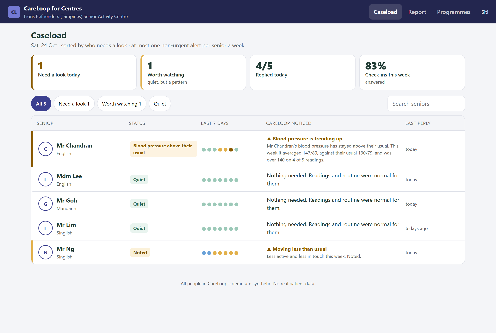

One senior: the day-by-day log, patterns in their own data, a befriending record ready to paste, and the care plan.

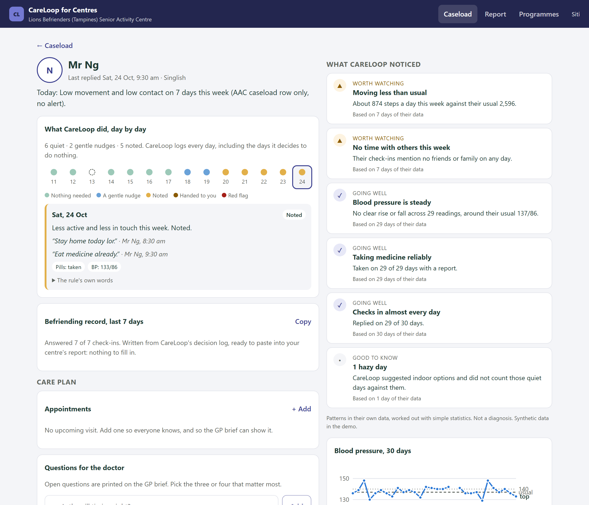

Programmes: the centre types in its timetable once; CareLoop shows which seniors each programme suits and suggests them.

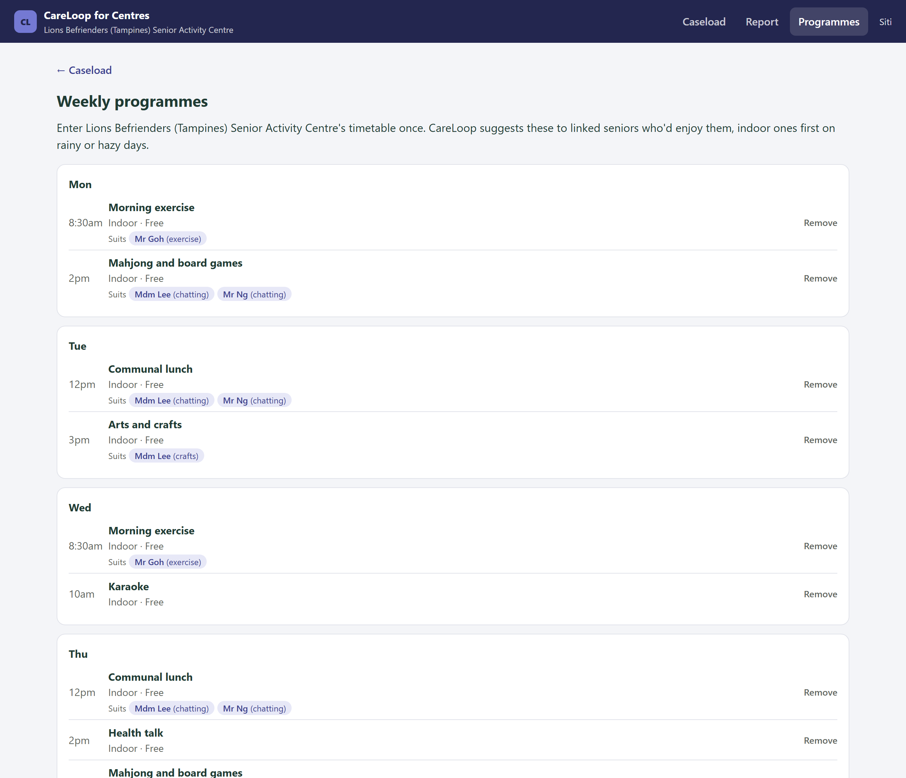

## Layout

```
contracts/     schemas + example JSON for every object      (Vibu)
backend/
  engine/      trust check, baseline, context, rules, ladder, decision log   (Vibu)
  env/         data.gov.sg PSI + rainfall, with offline fixtures            (Vibu)
  synth/       persona generator, tuning set, frozen held-out set          (Vibu)
  language/    transcription, extraction, writer, guardrail, model chain    (Mingyu)
  reports/     GP brief PDF, patterns, activities, timetable import,
               medicines explained, staying well                            (Nathan)
  healthsync/  Apple Health / Health Connect records -> readings; phone simulator (Nathan)
  api/         HTTP endpoints, demo seed; serve.py for the deploy            (Vibu; serve.py Nathan)
web/           React + Vite, one build: / home, /senior, /care
  shared/      design tokens, API client, i18n strings   (Nathan tokens, Mingyu i18n)
  senior/      the /senior app                           (Mingyu)
  care/        /care chooser, family app, centre console (Nathan)
docs/          architecture, evaluation, build log, user research, Tencent tools log, screenshots
```

## Run it

```
# API (Python 3.10+), seeded with the synthetic demo
python -m venv .venv && .venv/Scripts/pip install -r backend/requirements.txt
CARELOOP_SEED=demo .venv/Scripts/python -m uvicorn backend.api.app:app --port 8787

# Web app against the API (web/.env.live points at :8787)
cd web && npm install && npm run dev:live
```

Without the API (`npm run dev`), the apps run on in-browser mocks in the same shapes.

**Home page:** `/`.

**Senior app:** `/senior?senior=tan` (the demo senior). Say "I'm fine lah, BP 186/112" for the red flag.

**Caregiver app:**
- `/care`: pick who you are. Family and centre staff get separate apps.
- `/care/family?contact=tan-weiling`: the family app (Today, Health, Plan, Activities, You). Use `?contact=tan-kelvin` in a second tab to act as Kelvin: claims show for both.
- `/care/aac?worker=aac-siti`: CareLoop for Centres, the AAC staff console (`?worker=aac-farid` for the second centre). `/care/aac/programmes` is the timetable, its import, and who each programme suits.
- `?demo`: a bar to move the demo clock (+1 day, +11 days for the video's fortnight, reset). API only.
- Mocks only: `?scenario=quiet`, `?scenario=redflag` (both views).

### Hosting

One Render web service (Singapore, free plan) runs `backend/api/serve.py`: the API under `/api` and the built web app at every other path, so phones get one HTTPS address. It deploys on every push to `main`.

```
pip install -r backend/requirements.txt && cd web && npm ci --include=dev && npm run build      # build (VITE_API_URL=/api)
uvicorn backend.api.serve:site --host 0.0.0.0 --port $PORT                                       # start
```

Environment: `CARELOOP_SEED=demo`, `CARELOOP_DEMO_DAYS=11` (plays the fortnight on a fresh store), `VITE_API_URL=/api`, `PYTHON_VERSION=3.11.9`, `NODE_VERSION=20.18.0`. The store is SQLite on the service's own disk, which is wiped when it restarts or sleeps; for the demo that means it starts again from 24 Oct. Postgres (`DATABASE_URL`) is supported by the store but not run yet.

### On a phone, as an app

The senior app, the family app and the centre console each install as their own app ("Add to Home Screen"), with their own icon and name, full screen with no browser bar. The app itself opens without a connection; health data always comes fresh from the API.

```
cd web && npx vite build --mode live && npm run preview -- --port 4173     # the installable build
```

- Installing needs the production build (`npm run dev` has no service worker, so edits show at once) and HTTPS, or `localhost` on the same computer. To try it on a real phone, the app has to be hosted on HTTPS.
- Android or desktop Chrome: the browser offers "Install app", or use the button in the family app's You tab. iPhone: Safari, Share, "Add to Home Screen".
- An installed app opens at its start page without `?senior=`, `?contact=` or `?worker=`, so the app remembers the last one it was given. For the demo, open `/senior?senior=tan` (or `/care/family?contact=tan-kelvin`) once, then install.

## Tests and evaluation

Offline, with no keys and no network.

```
for s in language engine api synth reports healthsync; do .venv/Scripts/python -m unittest discover -s backend/$s/tests -t .; done
python -m backend.synth.evaluate --heldout     # docs/evaluation.md; read docs/evaluation-notes.md too
```

## Real vs synthetic

All senior data in this repo is synthetic. Clinical thresholds, the red-flag wording, the medicine notes and the check-up intervals are placeholders until a clinician signs off.
