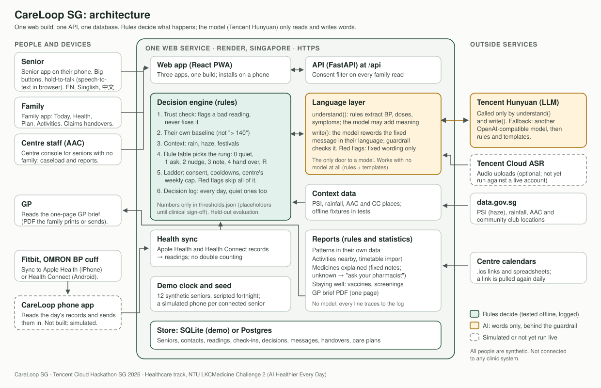
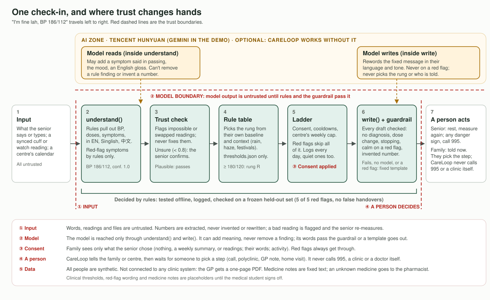

# Architecture, trust boundaries and design trade-offs

CareLoop SG is for NTU LKCMedicine Challenge 2, "AI Healthier Every Day" (Scenario 3: hypertension in adults 65+).
It supports seniors between doctor visits, stays quiet while things are normal for *them*, and hands over to their
family, or to their Active Ageing Centre if they have no family, with the evidence.

**Rules pick what happens. The model only reads and writes words.**

PNG copies for slides: [architecture.png](architecture/architecture.png), [trust-boundaries.png](architecture/trust-boundaries.png).

## 1. The system

| Part | What it does | Code |
|---|---|---|
| Web app | Three apps in one React build, installable on a phone: the senior app, the family app, the centre console | `web/` |
| API | FastAPI under `/api`. Every family read goes through the senior's consent | `backend/api/app.py` |
| Decision engine | Trust check, the senior's own baseline, context (rain, haze, festivals), the rule table that picks the rung, the ladder (consent, cooldowns, the centre's weekly cap, handovers) and the decision log | `backend/engine/` |
| Language layer | `understand()` and `write()`, the guardrail, fixed templates, the model chain. The only way to reach a model | `backend/language/` |
| Reports | Patterns in their own data, activities nearby, timetable import, medicines explained, staying well, the GP brief PDF. Rules and statistics; no model | `backend/reports/` |
| Health sync | Apple Health and Health Connect records (Fitbit, OMRON cuff) become readings | `backend/healthsync/` |
| Context data | data.gov.sg PSI, rainfall, AAC and community club locations; offline fixtures in tests | `backend/env/` |
| Store | SQLite for the demo, Postgres for a real deployment | `backend/api/store.py` |

It runs as one service (`backend/api/serve.py`) on Render in Singapore: https://careloop-sg.onrender.com.

## 2. Trust boundaries

1. **Input.** Words, readings and files are untrusted. Rules extract numbers; nothing invents or rewrites one. The trust
   check flags an impossible or swapped reading and the senior re-measures. A reading the language layer is unsure of
   (confidence below 0.8) is confirmed by the senior.
2. **Model.** The model is reached only through `understand()` and `write()`.
   - It can add meaning: a symptom said in a roundabout way, the mood, an English gloss.
   - It can't remove a rule finding.
   - A BP number from the model is kept only if both numbers are in the text, and then at confidence 0.5.
   - Every draft passes the guardrail (no diagnosis, no dose change, no stopping a medicine, no calm words on a red
     flag, no outdoor advice during haze, no invented number), or the fixed template for that rung goes out.
3. **Consent.** Family sees only what the senior chose: nothing, a weekly summary, or readings, and whether their words
   and activity are shared. Red flags always reach them.
4. **A person decides.** CareLoop tells the family or centre, then waits for someone to pick a step (call, polyclinic,
   GP note, home visit). It never calls 995, a clinic or a doctor itself. Red flags skip baseline, context, consent,
   cooldowns, the weekly cap and open handovers.
5. **Data.** All people are synthetic. CareLoop isn't connected to any clinic system; the GP gets a one-page PDF.
   Medicine notes are fixed text, and a medicine CareLoop doesn't know goes to the pharmacist.

## 3. How the prompts drive the AI

The model chain is Tencent Hunyuan (`hunyuan-turbos-latest`, OpenAI-compatible endpoint), then any other
OpenAI-compatible model, then no model (rules and templates). Each prompt narrows the model to one job.

- **Reading** (`backend/language/understand.py`): "You read a short check-in from an older Singaporean with high blood
  pressure. They may speak English, Singlish or Mandarin…" The model returns JSON only: an English gloss (numbers kept
  exactly), symptoms from a fixed list in the person's own words, activities, doses, medicines running out, mood, and BP
  only if the person said the numbers. It's given Singlish ("eat medicine" means took medicine, "pengsan" means fainted)
  and told: "Do not judge whether anything is dangerous. Do not give advice. Do not guess numbers." Its answer is merged
  into what the rules found, never the other way round.
- **Writing** (`backend/language/write.py`): "The rung (what kind of message) is already decided. Write ONLY the message
  text." The hard rules repeat the guardrail: never diagnose, never mention a dose, never start a senior's message with a
  number, never reassure on a red flag, never suggest going out during haze, at most three short sentences. The prompt
  carries the rung and what it means, the audience, the language, the facts and the context (name, contact, place, haze).
- **Then the guardrail checks the draft anyway.** A prompt asks; the guardrail enforces.

## 4. Key design trade-offs

| We chose | Instead of | What it buys | What it costs |
|---|---|---|---|
| Rules pick the rung; the model only handles words | An LLM deciding who to alert | Every decision is explainable, logged, tested offline, and measured on a frozen held-out set (5 of 5 red flags, 16 of 17 real problems, no false handovers) | Less nuance: a new situation needs a new rule |
| The senior's own baseline | A fixed "BP over 140" alert | No false handovers (the fixed rule sends about 1.3 per persona-month), and it sees missed medicine, days unwell, isolation | Drifts are handed over 3 to 10 days later than the fixed rule. We lead the evaluation page with this loss |
| Quiet by default: ask, nudge and note first; cooldowns; at most one non-urgent centre alert per senior a week | Alerting on everything | Families and centres keep trusting the alerts | A slow problem waits a few days. Red flags never wait |
| A fixed template when the model fails or is missing | Model-only messages | Works with no key and no network; the demo survives a dead API | Template wording is plainer |
| Fixed, reviewable medicine notes | A model explaining medicines | Never crosses into medication advice; a pharmacist can check every line; unknown medicines are never guessed | Covers 17 common medicines; anything else goes to the pharmacist |
| Speech-to-text in the browser | Tencent Cloud ASR first | Free and on the phone | Quality varies by browser and needs HTTPS; Tencent ASR is wired up but not yet run live |
| A web app that installs on a phone | A native app | One build for three apps, seniors, families and centres alike | Can't read Apple Health or Health Connect: that needs a small native app (simulated in the demo) |
| One service, SQLite on the free plan | Always-on Postgres | Simple; one HTTPS address | The free plan sleeps when idle and the demo resets |
| Synthetic people, generated with planted events | MIMIC-III or Kaggle data | Home BP between visits in Singapore, in three languages, with a known answer for every event; no privacy risk | Not real patients. Thresholds and wording are placeholders until the medical student signs off |

## 5. Real, simulated, not yet

| Real and running | Simulated | Not yet |
|---|---|---|
| Engine, language rules, guardrail, templates, consent, handovers, reports, GP brief, medicine notes, staying well, timetable import, the hosted site | The senior's phone syncing Fitbit and OMRON data; the demo clock and 12 synthetic seniors | A Hunyuan key on the hosted site; Tencent Cloud ASR against a live account; Postgres; installing on a real phone; clinical sign-off |
